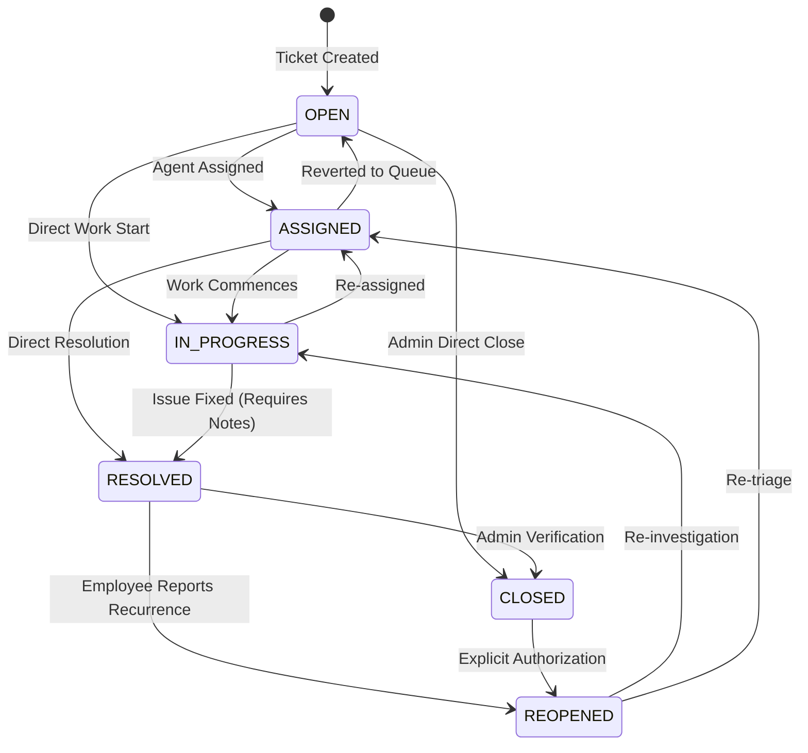

# TrackIT — System Architecture & Design Documentation

## 1. Architectural Philosophy: Modular Monolith & Clean Architecture

TrackIT is engineered as a **Clean Architecture Modular Monolith**. Instead of premature microservices distribution—which introduces distributed transaction overhead, network latency, and orchestration complexity—TrackIT enforces strict **Separation of Concerns (SoC)** internally through distinct layers:

```
┌────────────────────────────────────────────────────────┐
│                   CLIENT (React SPA)                   │
└───────────────────────────┬────────────────────────────┘
                            │ HTTP / JSON (REST APIs)
┌───────────────────────────▼────────────────────────────┐
│                    FASTAPI APPLICATION                 │
│                                                        │
│  ┌──────────────────────────────────────────────────┐  │
│  │ Middlewares (Logging, Auth, Exception Handlers)  │  │
│  └──────────────────────────┬───────────────────────┘  │
│                             │                          │
│  ┌──────────────────────────▼───────────────────────┐  │
│  │ Routes / Presentation Layer                      │  │
│  │ (app/routes/*.py)                                │  │
│  └──────────────────────────┬───────────────────────┘  │
│                             │                          │
│  ┌──────────────────────────▼───────────────────────┐  │
│  │ Service / Business Logic Layer                   │  │
│  │ (app/services/*.py: SLA, Priority, Auth, Ticket) │  │
│  └──────────────────────────┬───────────────────────┘  │
│                             │                          │
│  ┌──────────────────────────▼───────────────────────┐  │
│  │ Repository / Data Access Layer                   │  │
│  │ (app/repositories/*.py: DB queries, aggregates)  │  │
│  └──────────────────────────┬───────────────────────┘  │
│                             │                          │
│  ┌──────────────────────────▼───────────────────────┐  │
│  │ Models & Database Connection                     │  │
│  │ (SQLAlchemy ORM + Connection Pooling)            │  │
│  └──────────────────────────────────────────────────┘  │
└───────────────────────────┬────────────────────────────┘
                            │ TCP / Port 5432
┌───────────────────────────▼────────────────────────────┐
│              PostgreSQL Relational Database            │
└────────────────────────────────────────────────────────┘
```

---

## 2. Layer Responsibilities

1. **Routes (Presentation Layer):**
   * Translates incoming HTTP requests into typed Pydantic payloads.
   * Injects dependencies (database sessions, authenticated user identity, role authorization checks).
   * Formats outbound data into standard `ApiResponse[T]`.
   * **Rule:** Contains zero raw SQL queries or business rules.

2. **Services (Business Logic Layer):**
   * Encapsulates domain logic: SLA due date calculation, state machine transition validation, priority recommendation heuristics, and permission checks.
   * Orchestrates between multiple repositories and triggers audit log events.

3. **Repositories (Data Access Layer):**
   * Implements the **Repository Pattern** to abstract database operations away from business logic.
   * Executes optimized queries using SQLAlchemy, eager loading (`joinedload`), pagination offsets, and grouping aggregations.
   * Derives from a generic `BaseRepository[T]` demonstrating DRY principle.

4. **Schemas (Data Transfer Objects - DTOs):**
   * Pydantic v2 schemas validating request inputs and strictly shaping outbound responses (preventing password leaks or sensitive metadata exposure).

5. **Models (Database Entities):**
   * Pure declarative SQLAlchemy definitions representing relational tables, foreign key constraints, indexes, and cascades.

---

## 3. Core Ticket Lifecycle State Machine

Ticket transitions are governed by a deterministic finite state machine (FSM) implemented in `TicketService.VALID_TRANSITIONS`:



### Transition Validation Rules:
* Moving to `RESOLVED` mandates a non-empty `resolution_notes` payload ($\ge 5$ chars).
* Directly moving from `CLOSED` to `IN_PROGRESS` is prohibited; the ticket must explicitly follow the `CLOSED -> REOPENED` path.
* Modifying ticket attributes (title, description) while `CLOSED` is blocked by the backend.

---

## 4. Object-Oriented Programming (OOP) in TrackIT

1. **Encapsulation:**
   * Business services (e.g., `TicketService`, `AuthService`, `SLAService`) encapsulate private helpers (such as `_enrich_ticket_response`) and state transition dictionaries, preventing external tampering.
2. **Abstraction:**
   * Route handlers depend on high-level service interfaces rather than raw database sessions or low-level SQL syntax.
3. **Inheritance & Generics:**
   * `BaseRepository[ModelType]` provides generic CRUD methods (`get_by_id`, `create`, `update`, `delete`, `count`), which specialized repositories (`UserRepository`, `TicketRepository`, `CategoryRepository`) inherit and extend.
4. **Polymorphism:**
   * Dynamic role-based handling in dashboard calculations: `get_summary(user)` polymorphic behavior adjusts query scoping based on whether the caller is an `EMPLOYEE` (scoped to `created_by`), `SUPPORT_AGENT` (scoped to `assigned_to`), or `ADMIN` (organization-wide).

---

## 5. Algorithmic & Data Structure Highlights

* **Dictionary Hash Maps ($O(1)$ lookup):**
  Used in `VALID_TRANSITIONS` for constant-time state validation, and priority-to-SLA configuration mappings (`settings.get_sla_hours_for_priority`).
* **Rule-Based Decision Engine ($O(1)$ evaluation):**
  `PriorityRecommendationEngine.recommend` evaluates impact matrices (blast radius $\times$ infrastructure criticality $\times$ security flag) to return deterministic suggestions without arbitrary overhead.
* **In-Memory Aggregations:**
  `DashboardService` efficiently iterates ticket collections to compute breach counts, duration averages, and compliance percentages in a single linear pass ($O(N)$ time, $O(1)$ auxiliary space).
