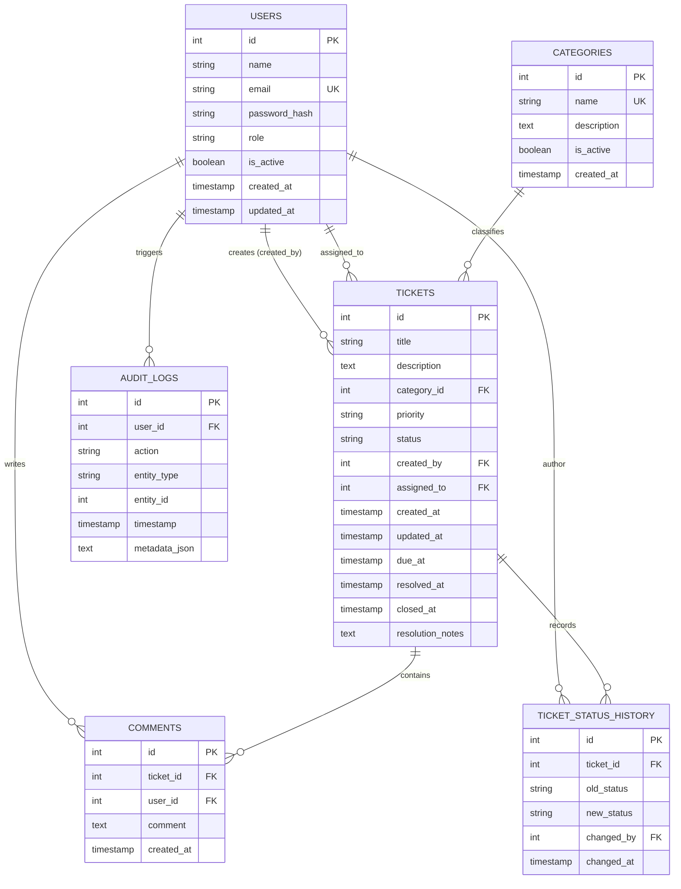

# TrackIT — Relational Database Architecture & Design

TrackIT employs a normalized **PostgreSQL** schema managed via **SQLAlchemy 2.0 ORM** and version-controlled using **Alembic**.

---

## 1. Entity-Relationship Diagram

---

## 2. Table Specifications & Normalization

All tables adhere to **Third Normal Form (3NF)**:
1. **1NF:** All attributes are atomic (no repeating groups, scalar types).
2. **2NF:** Every non-key attribute is fully functionally dependent on the primary key (no partial dependencies).
3. **3NF:** No non-key attribute depends transitively on another non-key attribute.

### `users`
* `id` (INTEGER, PK): Auto-incrementing identifier.
* `name` (VARCHAR(100), NOT NULL): Employee full name.
* `email` (VARCHAR(255), UNIQUE, NOT NULL): Corporate email address.
* `password_hash` (VARCHAR(255), NOT NULL): Salted bcrypt cryptographic hash.
* `role` (VARCHAR(50), NOT NULL): Role identifier (`EMPLOYEE`, `SUPPORT_AGENT`, `ADMIN`).
* `is_active` (BOOLEAN, NOT NULL): Soft-deletion flag enabling immediate account revocation without breaking foreign key referential integrity.
* `created_at`, `updated_at` (TIMESTAMP WITH TIME ZONE).

### `categories`
* `id` (INTEGER, PK): Primary key.
* `name` (VARCHAR(100), UNIQUE, NOT NULL): Issue classification (Hardware, Software, Network, Access, Email, Security, Other).
* `description` (TEXT): Classification guidance for submitters.
* `is_active` (BOOLEAN, NOT NULL): Controls whether category is selectable in new tickets.

### `tickets`
* `id` (INTEGER, PK): Unique ticket number.
* `title` (VARCHAR(200), NOT NULL): Short summary of technical problem.
* `description` (TEXT, NOT NULL): Reproducible steps and error logs.
* `category_id` (INTEGER, FK $\rightarrow$ `categories.id`, NOT NULL): Relational categorization.
* `priority` (VARCHAR(20), NOT NULL): `LOW`, `MEDIUM`, `HIGH`, `CRITICAL`.
* `status` (VARCHAR(30), NOT NULL): `OPEN`, `ASSIGNED`, `IN_PROGRESS`, `RESOLVED`, `CLOSED`, `REOPENED`.
* `created_by` (INTEGER, FK $\rightarrow$ `users.id`, NOT NULL): Submitter foreign key.
* `assigned_to` (INTEGER, FK $\rightarrow$ `users.id`, NULLABLE): Assigned agent foreign key.
* `created_at`, `updated_at` (TIMESTAMP WITH TIME ZONE).
* `due_at` (TIMESTAMP WITH TIME ZONE, NULLABLE): Target SLA deadline computed dynamically upon creation.
* `resolved_at` (TIMESTAMP WITH TIME ZONE, NULLABLE): Recorded when status changes to `RESOLVED`.
* `closed_at` (TIMESTAMP WITH TIME ZONE, NULLABLE): Recorded when status changes to `CLOSED`.
* `resolution_notes` (TEXT, NULLABLE): Actionable post-mortem explanation of remedy applied.

### `comments`
* `id` (INTEGER, PK): Primary key.
* `ticket_id` (INTEGER, FK $\rightarrow$ `tickets.id` ON DELETE CASCADE, NOT NULL): Cascade deletion guarantees no orphaned messages if ticket is purged.
* `user_id` (INTEGER, FK $\rightarrow$ `users.id`, NOT NULL): Comment author.
* `comment` (TEXT, NOT NULL): Markdown-supported reply text.
* `created_at` (TIMESTAMP WITH TIME ZONE).

### `ticket_status_history`
* `id` (INTEGER, PK): Primary key.
* `ticket_id` (INTEGER, FK $\rightarrow$ `tickets.id` ON DELETE CASCADE, NOT NULL): Target ticket.
* `old_status` (VARCHAR(30), NULLABLE): Prior state in lifecycle (null for initial creation).
* `new_status` (VARCHAR(30), NOT NULL): State transitioned into.
* `changed_by` (INTEGER, FK $\rightarrow$ `users.id`, NOT NULL): Identity of actor executing transition.
* `changed_at` (TIMESTAMP WITH TIME ZONE): Exact timestamp of transition.

### `audit_logs`
* `id` (INTEGER, PK): Primary key.
* `user_id` (INTEGER, FK $\rightarrow$ `users.id`, NULLABLE): Actor triggering event.
* `action` (VARCHAR(100), NOT NULL): Event code (`TICKET_CREATED`, `USER_LOGIN`, `TICKET_ASSIGNED`).
* `entity_type` (VARCHAR(50), NOT NULL): `TICKET`, `USER`, `CATEGORY`.
* `entity_id` (INTEGER, NULLABLE): Identifier of entity affected.
* `timestamp` (TIMESTAMP WITH TIME ZONE): UTC timestamp.
* `metadata_json` (TEXT, NULLABLE): JSON stringified structured context.

---

## 3. Database Indexes & Query Optimization

| Index | Column(s) | Type | Rationale |
| :--- | :--- | :--- | :--- |
| `idx_users_email` | `users.email` | B-Tree (Unique) | Accelerates user authentication lookup during login from $O(N)$ sequential table scan to $O(\log N)$ or $O(1)$ index seek. |
| `idx_tickets_status` | `tickets.status` | B-Tree | Critical for agent workbench filtering (e.g. `WHERE status = 'OPEN'`) and dashboard KPI grouping queries (`GROUP BY status`). |
| `idx_tickets_priority` | `tickets.priority` | B-Tree | Speeds up SLA priority queues and sorting. |
| `idx_tickets_created_by`| `tickets.created_by`| B-Tree | Enforces fast employee data scoping (`WHERE created_by = :current_user`) preventing full table scans on large volumes. |
| `idx_tickets_assigned_to`| `tickets.assigned_to`| B-Tree | Optimizes agent personal queue lookups. |
| `idx_tickets_created_at`| `tickets.created_at`| B-Tree | Enables efficient range queries and pagination (`ORDER BY created_at DESC LIMIT 20`). |
| `idx_tickets_due_at` | `tickets.due_at` | B-Tree | Speeds up real-time evaluation of approaching SLA breaches (`WHERE due_at <= NOW()`). |

---

## 4. Algorithmic Complexity (DSA in Database Operations)

1. **Indexed Primary Key / Email Lookups:**
   * PostgreSQL uses **B-Tree indexes** by default.
   * Search complexity is $O(\log_B N)$, where $B \approx 100$ branch factor. On a dataset of $1,000,000$ tickets, lookup requires $\le 4$ block reads rather than scanning $1,000,000$ rows.
2. **Eager Relationship Loading (`joinedload`):**
   * Eliminates the classic **$N+1$ query problem**. When fetching 20 tickets with their associated categories and creators, SQLAlchemy executes 1 optimized `LEFT OUTER JOIN` query ($O(1)$ round trips) rather than $1 + 20 + 20 = 41$ queries ($O(N)$ round trips).
3. **Cursor / Offset Pagination:**
   * Pagination uses indexed ordering `ORDER BY created_at DESC OFFSET :skip LIMIT :limit` to maintain predictable latency for dashboard lists.
