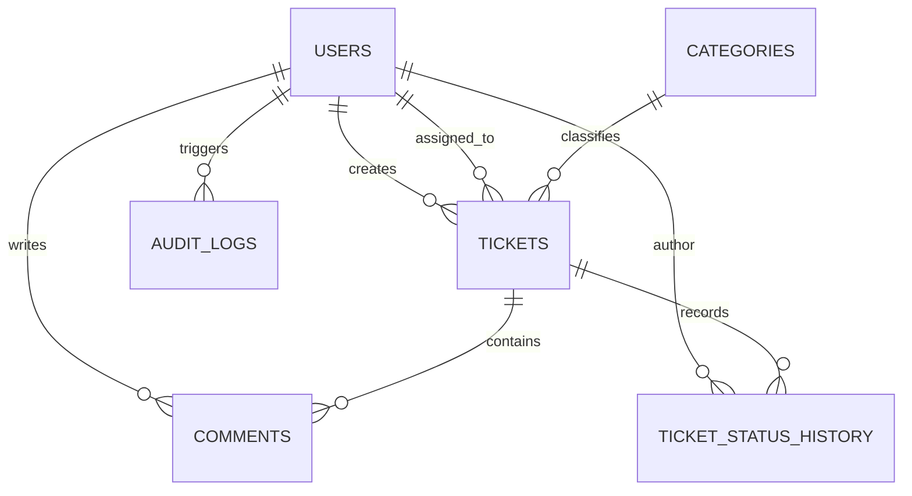
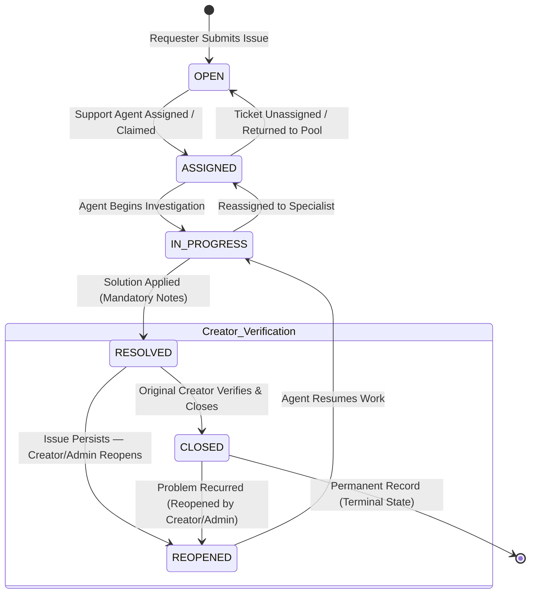

# TrackIT — Smart IT Service & Issue Management Platform

[](https://www.python.org/)
[](https://fastapi.tiangolo.com/)
[](https://react.dev/)
[](https://www.postgresql.org/)
[](https://www.docker.com/)
[](https://github.com/features/actions)
[](LICENSE)

**TrackIT** is a production-inspired IT Service Management and Issue Tracking platform designed to streamline internal technical support operations. It replaces chaotic, informal support requests with a structured, auditable service management workflow featuring rule-based priority advisory, real-time SLA deadline tracking, incident intelligence, and operational executive analytics.

Built using **Python (FastAPI)**, **PostgreSQL (SQLAlchemy & Alembic)**, and **React (Vite & Modern CSS)**, TrackIT is architected as an interview-ready, production-style software platform demonstrating clean architecture, OOP principles, practical DSA, and comprehensive automated test coverage.

---

## Table of Contents
1. [Problem Statement & Product Vision](#1-problem-statement--product-vision)
2. [User Personas & Role Permissions](#2-user-personas--role-permissions)
3. [Key Features](#3-key-features)
4. [Technology Stack](#4-technology-stack)
5. [Architecture & Project Structure](#5-architecture--project-structure)
6. [Database Schema & ER Diagram](#6-database-schema--er-diagram)
7. [Core Ticket Lifecycle & Finite State Machine](#7-core-ticket-lifecycle--finite-state-machine)
8. [Smart Priority Advisor & Dynamic SLA Engine](#8-smart-priority-advisor--dynamic-sla-engine)
9. [Incident Intelligence Engines](#9-incident-intelligence-engines)
10. [Authentication & Security](#10-authentication--security)
11. [Append-Only Audit Trail](#11-append-only-audit-trail)
12. [Dashboard Analytics & KPIs](#12-dashboard-analytics--kpis)
13. [Local Development Quickstart](#13-local-development-quickstart)
14. [Docker & Containerized Deployment](#14-docker--containerized-deployment)
15. [Automated Testing Suite](#15-automated-testing-suite)
16. [API Documentation & Postman Collection](#16-api-documentation--postman-collection)
17. [Documentation Directory](#17-documentation-directory)

---

## 1. Problem Statement & Product Vision

In growing organizations, IT service requests (hardware defects, VPN failures, access grants, software provisioning) frequently occur over informal, scattered channels: emails, chat messages, or walk-ups. This results in:
* **Zero Accountability**: Issues slip through the cracks without assigned ownership.
* **No SLA Predictability**: Absence of objective deadlines to guarantee resolution timeframes.
* **Incident Duplication**: Multiple users file redundant tickets for identical underlying infrastructure outages without detection.
* **Lack of Visibility**: IT leadership lacks empirical metrics on Mean Time to Resolution (MTTR), recurring failure categories, and agent caseloads.

**TrackIT** establishes an accountable, structured lifecycle:

```text
Employee Submission
        ↓
Automated SLA / Priority Triage
        ↓
Agent Assignment
        ↓
Investigation & Progress
        ↓
Resolution
        ↓
Creator Verification
        ↓
Closure

Reopen path:
RESOLVED → REOPENED → IN_PROGRESS
```

---

## 2. User Personas & Role Permissions

Role-Based Access Control (RBAC) is **strictly enforced at the backend API layer** via FastAPI dependency injection and query-level isolation:

| Capability / Action | EMPLOYEE | SUPPORT_AGENT | ADMIN | Enforcement Mechanism |
| :--- | :---: | :---: | :---: | :--- |
| Self-Register & Log In | ✅ | ✅ | ✅ | `POST /auth/register`, `POST /auth/login` |
| View Own Reported Tickets | ✅ | ✅ | ✅ | Query automatically filtered by `created_by` |
| View Global Ticket Queue | ❌ *(403 Forbidden)* | ✅ | ✅ | Route dependency check |
| Submit Ticket (Self) | ✅ | ✅ | ✅ | `POST /tickets` |
| Submit Ticket on Behalf of Employee | ❌ *(403 Forbidden)* | ✅ | ✅ | `on_behalf_of_id` guarded by role check |
| Assign / Claim Ticket | ❌ *(403 Forbidden)* | ✅ | ✅ | `POST /tickets/{id}/assign` |
| Advance Status (`IN_PROGRESS`) | ❌ *(403 Forbidden)* | ✅ | ✅ | `POST /tickets/{id}/status` |
| Resolve Ticket (Mandatory Notes) | ❌ *(403 Forbidden)* | ✅ | ✅ | `POST /tickets/{id}/resolve` |
| Verify & Close Resolved Ticket | ✅ *(Creator Only)* | ✅ *(Creator Only)* | ✅ *(Creator Only)* | `POST /tickets/{id}/close` verifies creator ID |
| Reopen Ticket (If Problem Persists) | ✅ *(Own Only)* | ✅ | ✅ | `POST /tickets/{id}/reopen` |
| Permanently Delete Ticket | ❌ *(403 Forbidden)* | ❌ *(403 Forbidden)* | ✅ | `DELETE /tickets/{id}` requires `require_admin` |
| User Directory & Status Toggles | ❌ *(403 Forbidden)* | ❌ *(403 Forbidden)* | ✅ | `PATCH /users/{id}/status` |
| Category Management | ❌ Read-Only | ❌ Read-Only | ✅ | `POST/PUT /categories` |
| System Audit Trail | ❌ *(403 Forbidden)* | ❌ *(403 Forbidden)* | ✅ | `GET /audit-logs` |

---

## 3. Key Features

* **Incident Intelligence & Related Ticket Detection**: Pure-Python TF-IDF and Cosine Similarity engine that surfaces similar historical or active tickets ($\ge 0.65$ threshold) without external ML dependencies.
* **Smart Escalation Assessment**: Transparent, explainable rule engine that evaluates priority severity, blast radius, SLA pressure, and cluster density to generate actionable risk recommendations (`NORMAL`, `MONITOR`, `ESCALATION RECOMMENDED`).
* **Smart Priority Advisor**: Interactive blast-radius assessment recommending objective priority (`LOW`, `MEDIUM`, `HIGH`, `CRITICAL`) based on affected user count, outages, and security indicators.
* **Automated Dynamic SLA Engine**: Computes exact resolution deadlines (`due_at`) and live indicators (`ON_TRACK`, `AT_RISK`, `BREACHED`, `MET`) with proportional threshold evaluation.
* **Finite State Machine Lifecycle**: Validates legal status transitions and enforces mandatory diagnostic notes on resolution and creator-only closure verification.
* **Append-Only Application Audit Trail**: Logs critical system mutations with actor ID, timestamp, and JSON metadata; no mutation or deletion routes exist.
* **Collaborative Discussion Threads**: Multi-user comments with role badges and timestamp attribution.
* **Executive Analytics & Reporting**: Real-time MTTR, First Response Time, SLA compliance percentage, and caseload metrics.

---

## 4. Technology Stack

| Layer | Technologies |
| :--- | :--- |
| **Backend Framework** | Python 3.10+, FastAPI, Pydantic v2, Uvicorn |
| **Database & ORM** | PostgreSQL 16 (Production/Docker), SQLite (Local Dev/Pytest), SQLAlchemy 2.0, Alembic |
| **Frontend Framework** | React 18, Vite, React Router v6, Chart.js, Lucide Icons, Modern CSS |
| **Security & Auth** | Salted Bcrypt Hashing, JWT (HS256, 8-hour TTL), Role-Based Access Control (RBAC) |
| **Intelligence** | Pure-Python Vectorizer (TF-IDF), Cosine Similarity, Rule-Based Escalation Scoring |
| **DevOps & Containers** | Docker, Docker Compose, Nginx, GitHub Actions CI |
| **Testing** | Pytest, HTTPX, FastAPI TestClient (69 Automated Tests, 100% Pass Rate) |

---

## 5. Architecture & Project Structure

TrackIT is implemented following the **Clean Architecture Modular Monolith** pattern:

```
├── .github/workflows/ci.yml       # GitHub Actions automated test & build pipeline
├── backend/
│   ├── app/
│   │   ├── core/                  # Security (Bcrypt/JWT), Config, Logging, Exceptions, RBAC Guards
│   │   ├── database/              # Engine, Connection pooling, Sessionmaker, Declarative Base
│   │   ├── middleware/            # Structured Request Logging & Centralized Error Handlers
│   │   ├── models/                # SQLAlchemy ORM Models (User, Ticket, Category, Comment, History, Audit)
│   │   ├── repositories/          # Data Access Layer (Repository Pattern, eager loading, pagination)
│   │   ├── routes/                # REST Presentation Layer (Versioned v1 endpoints)
│   │   ├── schemas/               # Pydantic v2 DTOs (Request validation & response serialization)
│   │   └── services/              # Domain Business Logic (SLA, Priority, Intelligence, FSM)
│   ├── alembic/                   # Database schema migrations
│   ├── tests/                     # 69 Automated Unit, Integration, and API tests
│   ├── clean_data.py              # Zero-downtime test data reset utility
│   ├── requirements.txt           # Pinned backend dependencies
│   └── seed.py                    # Database initialization script
├── frontend/
│   ├── src/
│   │   ├── components/            # Reusable UI components (Modals, Badges, Tables, Navbars)
│   │   ├── context/               # AuthContext session provider
│   │   ├── hooks/                 # Custom React hooks (useAuth)
│   │   ├── pages/                 # Role workspaces (Employee, Agent, Admin, TicketDetails, AuditLogs)
│   │   ├── services/              # Axios API client services
│   │   └── index.css              # Responsive SaaS styling and design tokens
│   ├── package.json               # Frontend dependencies & scripts
│   └── vite.config.js             # Vite bundler configuration
├── docker-compose.yml             # Full-stack orchestration (PostgreSQL, Backend, Frontend)
├── .env.example                   # Environment configuration template
└── README.md                      # Project documentation
```

---

## 6. Database Schema & ER Diagram



All 6 relational tables (`users`, `categories`, `tickets`, `comments`, `ticket_status_history`, `audit_logs`) adhere to **Third Normal Form (3NF)**. Foreign key constraints and composite indexes eliminate sequential table scans.

---

## 7. Core Ticket Lifecycle & Finite State Machine

Every IT service request follows an immutable, strictly validated state machine defined in `TicketService.VALID_TRANSITIONS`:



### Documented Workflow Stages:
1. **Creation**: Requester fills ticket details $\to$ uses Smart Priority Advisor.
2. **Triage**: Ticket created in **`OPEN`** status with dynamic SLA clock.
3. **Assignment**: Agent self-assigns or Admin allocates $\to$ transitions to **`ASSIGNED`**.
4. **Investigation**: Agent commences diagnostics $\to$ transitions to **`IN_PROGRESS`**.
5. **Intelligence Evaluation**: Related ticket clusters and smart escalation scores are assessed in the ticket workspace.
6. **Technical Resolution**: Agent applies fix and provides mandatory resolution notes $\to$ transitions to **`RESOLVED`**.
7. **Creator Verification**: The original ticket creator inspects the resolution report:
   - **Satisfied**: Creator verifies and clicks **Close Ticket** $\to$ transitions to **`CLOSED`**.
   - **Problem Persists**: Creator clicks **Reopen Ticket** with reason $\to$ transitions to **`REOPENED`** $\to$ resumes in **`IN_PROGRESS`**.

---

## 8. Smart Priority Advisor & Dynamic SLA Engine

### Configured SLA Targets (`app/core/config.py`):
* **`CRITICAL`**: **4 Hours** SLA resolution target.
* **`HIGH`**: **8 Hours** SLA resolution target.
* **`MEDIUM`**: **24 Hours** SLA resolution target.
* **`LOW`**: **72 Hours** SLA resolution target.

### Real-Time SLA Evaluation Rules:
* **Due Date Formula**:
  ```text
  due_at = created_at + SLA_HOURS[priority]
  ```
* **`ON_TRACK`**: Active ticket where elapsed duration is $< 75\%$ of total SLA window.
* **`AT_RISK`**: Active ticket where elapsed duration is $\ge 75\%$ of SLA window, or $\le 1.0\text{h}$ remains.
* **`BREACHED`**: Active ticket past its `due_at` timestamp, or ticket resolved after deadline.
* **`MET`**: Ticket transitioned to `RESOLVED` on or before `due_at`.

### Smart Priority Advisor Algorithm:
Calculates objective priority via deterministic blast-radius scoring:
* **Business Impact**: `LOW` (5), `MEDIUM` (15), `HIGH`/`DEPARTMENT_BLOCKED` (25), `CRITICAL`/`ORG_BLOCKED` (45).
* **Blast Radius**: 1 user (0), 2–4 users (+5), 5–19 users (+10), 20–49 users (+15), 50–99 users (+25), $\ge 100$ users (+35).
* **Category Severity**: Security (+20), Network/Access (+10).
* **Outage / Blocker Flags**: Security incident (+50), Infrastructure outage (+50).
* **Thresholds**: Score $\ge 75 \implies$ `CRITICAL`, $\ge 35 \implies$ `HIGH`, $\ge 20 \implies$ `MEDIUM`, else `LOW`.

---

## 9. Incident Intelligence Engines

### 1. Related Ticket Detection (TF-IDF + Cosine Similarity)
* **Execution**: Evaluated on existing tickets via `GET /api/v1/intelligence/tickets/{ticket_id}/related` within the ticket workspace.
* **Candidate Pre-Filtering**: Queries up to 100 recent tickets matching the target's `category_id` or active statuses (`OPEN`, `ASSIGNED`, `IN_PROGRESS`, `REOPENED`).
* **Vectorization**: Pure-Python tokenizer, stop-word elimination, Term Frequency ($\text{TF}$), and smooth Inverse Document Frequency ($\text{IDF}$):
  $$\text{IDF}(t) = \ln\left(\frac{1 + |D|}{1 + \text{DF}(t)}\right) + 1.0$$
* **Matching**: Computes cosine similarity between sparse document vectors. Matches meeting the cutoff threshold ($\ge 0.65$) are ranked and returned (top 5 by default).

### 2. Smart Escalation Assessment (Rule-Based Risk Scoring)
Evaluates multi-factor operational signals to output an explainable integer `risk_score`:
* **Priority Severity**: `CRITICAL` (+2), `HIGH` (+1).
* **Blast Radius**: $\ge 20$ affected users (+2), $\ge 10$ affected users (+1).
* **SLA Pressure**: `BREACHED` (+2), `AT_RISK` (+1).
* **Cluster Density**: $\ge 5$ related tickets (+2), $\ge 3$ related tickets (+1).
* **Actionable Recommendations**:
  * Score `0 – 2`: **`NORMAL`**
  * Score `3 – 4`: **`MONITOR`**
  * Score `5+`: **`ESCALATION RECOMMENDED`**

---

## 10. Authentication & Security

* **Credential Security**: Passwords salted and hashed with **Bcrypt**.
* **Session Management**: Cryptographic **JWT tokens** signed via `HS256` with an **8-hour TTL** (`ACCESS_TOKEN_EXPIRE_MINUTES = 480`).
* **Input Validation**: Strongly typed Pydantic v2 schemas reject malformed payloads with structured HTTP 422 errors.
* **Clean Authentication Flow**: Users authenticate strictly via corporate email and password. No hardcoded credentials or demo quick-login buttons exist on the login interface.

---

## 11. Append-Only Audit Trail

* **Audited Operations**: User registration, login, account activation/deactivation, category creation/updates, ticket creation, status changes, assignments, resolutions, closures, reopenings, deletions, and intelligence queries.
* **Log Schema**: `id`, `user_id`, `action`, `entity_type`, `entity_id`, `timestamp`, `metadata_json`.
* **Append-Only Guarantees**: Handled via `AuditRepository.log_action`. The API exposes strictly a read-only endpoint (`GET /api/v1/audit-logs`) restricted to administrators. No update or delete endpoints exist.
* **Audit Trail Subtitle**: *"Append-only chronological logging of critical actions, mutations, and user activities."*

---

## 12. Dashboard Analytics & KPIs

| Metric | API Field | Description |
|---|---|---|
| **Mean Time to Resolution (MTTR)** | `avg_resolution_time_hours` | Average elapsed hours from ticket creation to technical resolution. |
| **First Response Time** | `avg_first_response_time_hours` | Average elapsed hours from ticket creation to first comment by a non-creator. |
| **Resolution Rate** | `resolution_rate` | $\frac{\text{Resolved} + \text{Closed}}{\text{Total Tickets}} \times 100\%$. |
| **SLA Breach Rate** | `sla_breach_rate` | Percentage of active/resolved tickets that exceeded SLA deadlines. |
| **SLA Compliance Rate** | `sla_compliance_rate` | Per-agent compliance percentage ($100 - \text{breach rate}$). |
| **Caseload Distribution** | `assigned_count`, `in_progress_count` | Real-time active ticket distribution per agent. |
| **Volume Distribution** | Status, Priority, Category | Aggregated counts and percentages across all dimensions. |

---

## 13. Local Development Quickstart

### Prerequisites:
* Python 3.10+
* Node.js 18+ and npm
* Git

### Step 1: Clone Repository & Configure Environment
```bash
git clone <repository_url>
cd "TrackIT — Smart IT Service & Issue Management Platform"
cp .env.example .env
```

### Step 2: Backend Setup
```powershell
# Create and activate Python virtual environment
python -m venv venv
.\venv\Scripts\Activate.ps1    # Windows PowerShell
# source venv/bin/activate     # Linux / macOS

# Install backend dependencies
pip install -r backend/requirements.txt

# Initialize database schema and seed standard categories and users
python backend/seed.py

# Start FastAPI server on port 8000
python -m uvicorn app.main:app --app-dir backend --reload --host 127.0.0.1 --port 8000
```
* **API Documentation (Swagger UI)**: `http://127.0.0.1:8000/docs`
* **API Documentation (ReDoc)**: `http://127.0.0.1:8000/redoc`
* **Health Probe**: `http://127.0.0.1:8000/health`

### Step 3: Frontend Setup
```bash
cd frontend
npm install
npm run dev
```
* **Frontend Web App**: `http://127.0.0.1:5173`

---

## 14. Docker & Containerized Deployment

TrackIT is fully containerized with multi-stage Docker builds:

```bash
# Build and run PostgreSQL 16, FastAPI Backend, and Nginx React Frontend
docker compose up --build -d
```

### Container Endpoints:
* **Web UI (Nginx)**: `http://localhost:3000`
* **Backend API & Swagger**: `http://localhost:8000/docs`
* **Health Check**: `http://localhost:8000/health`

To stop containers:
```bash
docker compose down -v
```

---

## 15. Automated Testing Suite

The testing suite contains **69 automated test cases** across unit, integration, and API layers:

```bash
# Run complete test suite (69 tests)
pytest -q

# Run unit tests only (SLA, Priority, Related Tickets, Escalation)
pytest backend/tests/unit -v

# Run integration tests (Multi-table SQL & Dashboard calculations)
pytest backend/tests/integration -v

# Run API & RBAC security tests
pytest backend/tests/api -v
```

### Test Suite Breakdown:
* **Authentication & JWT Tests** (12 tests): Password hashing, token encoding/decoding, expiration, invalid tokens.
* **RBAC & Security Tests** (9 tests): Row-level employee ticket isolation, unauthorized assignment prevention, admin user deactivation.
* **Ticket Lifecycle & Closure Tests** (10 tests): State transitions, mandatory resolution notes, creator-only closure verification, reopen workflows.
* **API Error Handling Tests** (6 tests): Standardized 400, 401, 403, 404, 409, 422 JSON envelopes.
* **Incident Intelligence Tests** (5 API tests + 11 Unit tests): Pure-Python vectorizer, candidate selection, cosine ranking, escalation risk score calculation.
* **SLA & Priority Tests** (12 unit tests): Clock-controlled SLA state evaluation (`ON_TRACK`, `AT_RISK`, `BREACHED`, `MET`), blast-radius scoring.
* **Dashboard Analytics Tests** (4 integration tests): Aggregations, MTTR, agent caseload, first response time.

---

## 16. API Documentation & Postman Collection

TrackIT includes interactive documentation and a pre-configured Postman collection:
* **Interactive Swagger UI**: `http://127.0.0.1:8000/docs`
* **Interactive ReDoc**: `http://127.0.0.1:8000/redoc`
* **Postman Collection**: `trackit_postman_collection.json` (includes automatic token extraction for subsequent requests).
