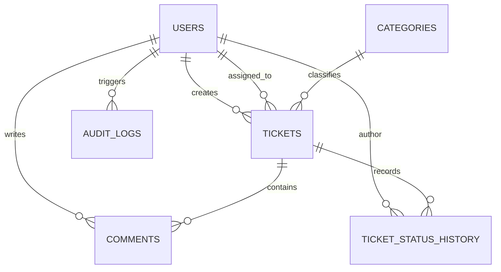
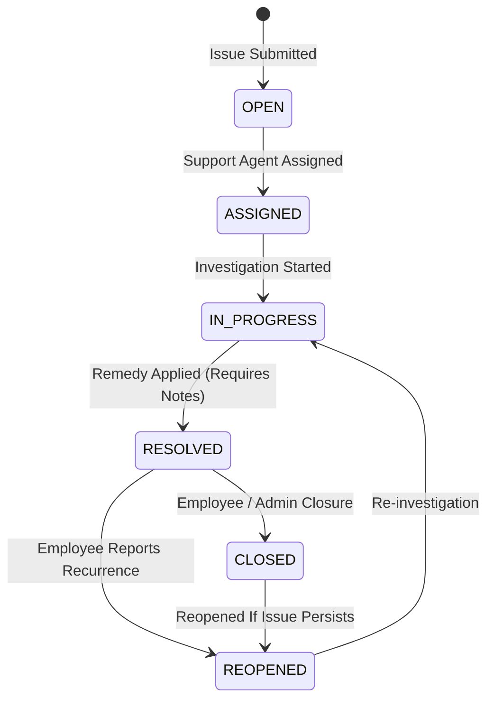

# TrackIT — Smart IT Service & Issue Management Platform

[](https://www.python.org/)
[](https://fastapi.tiangolo.com/)
[](https://react.dev/)
[](https://www.postgresql.org/)
[](https://www.docker.com/)
[](https://github.com/features/actions)
[](LICENSE)

**TrackIT** is an enterprise-grade IT Service Management (ITSM) and Issue Tracking platform designed to streamline internal workplace technical support. It bridges employee issue reporting, smart priority assessment, strict finite-state ticket lifecycles, real-time SLA deadline monitoring, and operational executive analytics.

Built using **Python (FastAPI)**, **PostgreSQL (SQLAlchemy & Alembic)**, and **React (Vite & Modern CSS)**, TrackIT is architected as an interview-ready, production-style software product demonstrating clean architecture, OOP principles, practical DSA, rigorous automated testing, and cloud deployment readiness.

---

## Table of Contents
1. [Problem Statement & Product Vision](#1-problem-statement--product-vision)
2. [User Personas & Role Permissions](#2-user-personas--role-permissions)
3. [Key Features](#3-key-features)
4. [Tech Stack](#4-tech-stack)
5. [Architecture & Design Decisions](#5-architecture--design-decisions)
6. [Database Schema & ER Diagram](#6-database-schema--er-diagram)
7. [Core Ticket Lifecycle & Finite State Machine](#7-core-ticket-lifecycle--finite-state-machine)
8. [Smart Priority Advisor & Dynamic SLA Engine](#8-smart-priority-advisor--dynamic-sla-engine)
9. [Local Development Quickstart](#9-local-development-quickstart)
10. [Docker & Docker Compose Deployment](#10-docker--docker-compose-deployment)
11. [Automated Testing Suite](#11-automated-testing-suite)
12. [API Reference & Postman Collection](#12-api-reference--postman-collection)
13. [Demo Login Credentials](#13-demo-login-credentials)
14. [AWS Cloud Deployment Architecture](#14-aws-cloud-deployment-architecture)
15. [Resume-Ready Project Description](#15-resume-ready-project-description)
16. [Documentation Directory](#16-documentation-directory)

---

## 1. Problem Statement & Product Vision

In fast-growing organizations, IT complaints (laptop defects, VPN failures, access requests, phishing reports) are typically submitted via fragmented channels: unstructured emails, WhatsApp chats, or direct Slack pings. This leads to:
* Issues being dropped or ignored with zero ownership.
* No service level agreements (SLAs) to guarantee turnaround deadlines.
* Inability for leadership to measure recurring hardware failures, agent throughput, or organizational MTTR (Mean Time to Resolution).

**TrackIT** replaces ad-hoc reporting with structured, auditable service management:
$$\text{Employee Report} \longrightarrow \text{Automated SLA/Priority Triage} \longrightarrow \text{Agent Investigation} \longrightarrow \text{Resolution} \longrightarrow \text{Verified Closure}$$

---

## 2. User Personas & Role Permissions

Role-Based Access Control (RBAC) is **strictly validated on the backend** via FastAPI dependency injection, never solely on the frontend.

| Capability / Action | EMPLOYEE | SUPPORT_AGENT | ADMIN |
| :--- | :---: | :---: | :---: |
| Self-Register & Log In | ✅ | ✅ | ✅ |
| View Own Reported Tickets | ✅ | ✅ | ✅ |
| View Other Employees' Tickets | ❌ *(403 Forbidden)* | ✅ | ✅ |
| Raise / Submit Ticket | ✅ | ✅ | ✅ |
| Assign / Reassign Agent | ❌ *(403 Forbidden)* | ✅ | ✅ |
| Advance Status (Triage / In Progress) | ❌ *(403 Forbidden)* | ✅ | ✅ |
| Resolve Ticket (with mandatory notes) | ❌ *(403 Forbidden)* | ✅ | ✅ |
| Reopen Ticket (if issue persists) | ✅ *(Own only)* | ✅ | ✅ |
| Permanently Delete Ticket | ❌ *(403 Forbidden)* | ❌ *(403 Forbidden)* | ✅ |
| View Operational Reports & KPIs | ❌ *(403 Forbidden)* | ✅ | ✅ |
| User Directory & Activate/Deactivate | ❌ *(403 Forbidden)* | ❌ *(403 Forbidden)* | ✅ |
| Category Management | ❌ *(403 Forbidden)* | ❌ *(403 Forbidden)* | ✅ |
| System Security Audit Trail | ❌ *(403 Forbidden)* | ❌ *(403 Forbidden)* | ✅ |

---

## 3. Key Features

* **Incident Intelligence & Related Ticket Detection (TF-IDF + Cosine Similarity):** Automatically analyzes ticket title and description against candidate tickets using normalized Term Frequency – Inverse Document Frequency (TF-IDF) and Cosine Similarity (threshold $\ge 0.65$) to surface duplicate or clustered issues.
* **Smart Escalation Recommendation (Rule-Based Risk Engine):** Evaluates blast radius (affected users $\ge 20$), ticket priority severity, real-time SLA deadline pressure, and related ticket clusters to output transparent, deterministic risk scores and recommendations (`NORMAL`, `MONITOR`, `ESCALATION RECOMMENDED`).
* **Intelligent Priority Advisor (Rule-Based):** Analyzes blast radius, infrastructure criticality, and security flags to recommend objective severity (`LOW`, `MEDIUM`, `HIGH`, `CRITICAL`).
* **Real-Time SLA Engine:** Calculates dynamic deadlines (`due_at`) and badges tickets as `ON_TRACK`, `AT_RISK` ($\le 4\text{h}$ remaining), `BREACHED`, or `MET`.
* **Finite State Machine Lifecycle:** Enforces legal transitions (`OPEN` $\rightarrow$ `ASSIGNED` $\rightarrow$ `IN_PROGRESS` $\rightarrow$ `RESOLVED` $\rightarrow$ `CLOSED`) with an authorized `REOPENED` loop and creator-only closure verification.
* **Audit Trail & Chronological History:** Every status change records `old_status`, `new_status`, `changed_by`, and `changed_at`.
* **Collaborative Discussion Thread:** Real-time commenting on tickets with role badges and timestamp attribution.
* **Live Analytics & Executive Dashboard:** Real-time resolution rates, breach percentage, and agent throughput graphs (Chart.js).

---

## 4. Tech Stack

| Tier | Technologies |
| :--- | :--- |
| **Backend** | Python 3.10+, FastAPI, Pydantic v2, SQLAlchemy 2.0, Alembic, Uvicorn |
| **Database** | PostgreSQL 16 (Production / Docker), SQLite (Local Dev / Pytest) |
| **Frontend** | React 18, Vite, React Router v6, Chart.js, Lucide Icons, Modern CSS |
| **Intelligence** | Pure-Python TF-IDF Vectorizer & Cosine Similarity, Rule-Based Escalation Engine |
| **Security** | Salted Bcrypt Hashing, JWT (HS256), RBAC Dependencies, Row-Level Isolation, CORS |
| **DevOps & CI/CD** | Docker, Docker Compose, Nginx, GitHub Actions |
| **Testing** | Pytest, HTTPX, FastAPI TestClient (69 Automated Tests, 100% Pass Rate) |

---

## 5. Architecture & Design Decisions

TrackIT follows the **Clean Architecture Modular Monolith** pattern:

```
backend/app/
├── core/            # Configuration, Security (Bcrypt/JWT), Logging, Exceptions, RBAC Dependencies
├── database/        # Connection pooling, Sessionmaker, Declarative Base
├── models/          # SQLAlchemy ORM models (User, Ticket, Category, Comment, History, Audit)
├── schemas/         # Pydantic v2 DTOs (Request input validation & outbound serialization)
├── repositories/    # Data Access Layer (Repository Pattern, eager loading, pagination)
├── services/        # Business Logic Layer (SLA Service, Priority Engine, Ticket FSM)
├── routes/          # REST Presentation Layer (Versioned v1 endpoints)
└── middleware/      # Structured Request Logging & Centralized Error Handling
```

* **OOP Principles Applied:**
  * **Encapsulation:** State machines and helper logic remain private to service modules.
  * **Abstraction:** Controllers interact with abstract repository contracts.
  * **Inheritance & Generics:** `BaseRepository[T]` encapsulates common database operations.
  * **Polymorphism:** Dynamic dashboard aggregation queries based on the caller's role.

---

## 6. Database Schema & ER Diagram



All 6 relational tables (`users`, `categories`, `tickets`, `comments`, `ticket_status_history`, `audit_logs`) are modeled in **Third Normal Form (3NF)**. Primary key and foreign key indexes optimize lookups from $O(N)$ sequential scans to $O(\log N)$ B-Tree seeks.

---

## 7. Core Ticket Lifecycle & Finite State Machine



---

## 8. Smart Priority Advisor & Dynamic SLA Engine

### SLA Durations (Configurable via Environment):
* **CRITICAL:** **4 Hours** SLA resolution target.
* **HIGH:** **8 Hours** SLA resolution target.
* **MEDIUM:** **24 Hours** SLA resolution target.
* **LOW:** **72 Hours** SLA resolution target.

### Real-Time SLA Status Rules:
* `ON_TRACK`: Elapsed time $< 75\%$ of SLA duration.
* `AT_RISK`: Elapsed time $\ge 75\%$ of SLA duration (or $\le 1.0\text{h}$ remaining).
* `BREACHED`: Current time has passed `due_at` (or resolved after deadline).
* `MET`: Ticket was marked `RESOLVED` on or before `due_at`.

---

## 9. Local Development Quickstart

### Step 1: Clone and Configure Environment
```bash
git clone <repository_url>
cd "TrackIT — Smart IT Service & Issue Management Platform"
cp .env.example .env
```

### Step 2: Backend Setup
```bash
# Create and activate Python virtual environment
python -m venv venv
.\venv\Scripts\Activate.ps1    # On Windows PowerShell
# source venv/bin/activate      # On Linux/macOS

# Install backend dependencies
pip install -r backend/requirements.txt

# Seed database with demo accounts, categories, and 22 tickets
python backend/seed.py

# Start FastAPI server
python -m uvicorn app.main:app --app-dir backend --reload --port 8000
```
Backend is live at `http://localhost:8000`  
Interactive Swagger API docs: `http://localhost:8000/docs`

### Step 3: Frontend Setup
```bash
cd frontend
npm install
npm run dev
```
Frontend is live at `http://localhost:5173`

---

## 10. Docker & Docker Compose Deployment

TrackIT is containerized for seamless production testing:
```bash
# Spin up PostgreSQL 16, FastAPI Backend, and Nginx React Frontend
docker compose up --build -d
```

### Accessing Containers:
* **Web UI:** `http://localhost:3000`
* **Backend API & Swagger:** `http://localhost:8000/docs`
* **Health Check Probe:** `http://localhost:8000/health`

To tear down:
```bash
docker compose down -v
```

---

## 11. Automated Testing Suite

The testing suite contains **48 comprehensive test cases** organized across `unit/`, `integration/`, and `api/` suites, validating authentication edge cases, RBAC boundaries, FSM state machine transitions, SLA evaluations (including controllable clock tests), and dashboard aggregations.

```bash
# Run complete test suite across all subdirectories
pytest backend/tests -v

# Run unit tests only (SLA & Priority engine)
pytest backend/tests/unit -v

# Run integration tests (Multi-table SQL & Dashboard calculations)
pytest backend/tests/integration -v

# Run API & RBAC tests
pytest backend/tests/api -v

# Generate code coverage report
pytest backend/tests --cov=app --cov-report=term-missing
```

---

## 12. API Reference & Postman Collection

TrackIT includes a complete Postman collection: `trackit_postman_collection.json`.
* **Automatic Token Extraction:** Executing the Login request automatically saves the JWT token into Postman environment variables, authenticating subsequent requests.
* **Endpoints Included:** Authentication (`/auth/*`), Users (`/users/*`), Categories (`/categories/*`), Tickets (`/tickets/*`), Comments (`/tickets/{id}/comments`), and Analytics (`/dashboard/*`).

---

## 13. Demo Login Credentials

*(Pre-seeded for local evaluation via `seed.py`)*

| Role | Email | Password | Intended Workflow |
| :--- | :--- | :--- | :--- |
| **Administrator** | `admin@trackit.internal` | `Admin@123` | Full system access, user deactivation, category editing, executive KPIs. |
| **Support Agent** | `agent.sarah@trackit.internal` | `Agent@123` | Ticket queue triage, assignment, status advancement, resolution. |
| **Support Agent** | `agent.john@trackit.internal` | `Agent@123` | Secondary agent for workload distribution and reassignment testing. |
| **Employee** | `emp.alice@trackit.internal` | `Employee@123` | Ticket creation, personal ticket tracking, reopening resolved issues. |
| **Employee** | `emp.bob@trackit.internal` | `Employee@123` | Testing isolation (cannot view Alice's tickets). |

---

## 14. AWS Cloud Deployment Architecture

TrackIT is deployment-ready for Amazon Web Services:
* **Frontend:** Static React build hosted in private **Amazon S3** and distributed globally via **AWS CloudFront** edge locations with SSL certificate.
* **Backend:** Containerized FastAPI service running on **AWS ECS Fargate** inside private subnets behind an **Application Load Balancer (ALB)**.
* **Database:** Managed **Amazon RDS PostgreSQL** (Multi-AZ) with automated daily snapshots.
* **Secrets:** Injected dynamically using **AWS Secrets Manager**.
* **Observability:** Application and access logs aggregated in **Amazon CloudWatch**.

---

## 15. Resume-Ready Project Description

> **TrackIT — Smart IT Service & Issue Management Platform**
> * Developed an enterprise-grade IT Service Management platform using **Python**, **FastAPI**, **React**, and **PostgreSQL**.
> * Implemented JWT authentication and server-side **Role-Based Access Control (RBAC)** across Employees, Support Agents, and Administrators.
> * Designed a normalized 3NF relational database with **SQLAlchemy 2.0** and **Alembic**, eliminating N+1 queries via eager loading (`joinedload`).
> * Built a deterministic ticket lifecycle state machine and dynamic **SLA compliance engine** (`ON_TRACK`, `AT_RISK`, `BREACHED`).
> * Engineered a rule-based **Priority Recommendation Engine** assessing blast radius to prevent priority inflation.
> * Authored **31 automated unit and integration tests** using `pytest`, achieving robust code coverage.
> * Packaged multi-stage **Docker** containers and established automated CI workflows using **GitHub Actions**.

---

## 16. Documentation Directory

For deep-dive architectural, database, and interview review, consult the detailed documentation:

* [Product Requirements & User Stories](file:///USER_STORIES.md)
* [System Architecture & Clean Architecture](file:///ARCHITECTURE.md)
* [Database Design & ER Diagram](file:///DATABASE.md)
* [REST API Specification](file:///API.md)
* [Security & Threat Model](file:///SECURITY.md)
* [Automated Testing Strategy](file:///TESTING.md)
* [Deployment & Cloud Architecture](file:///DEPLOYMENT.md)
* [Interview Preparation & 50+ Q&As](file:///docs/interview/10_possible_interview_questions.md)
