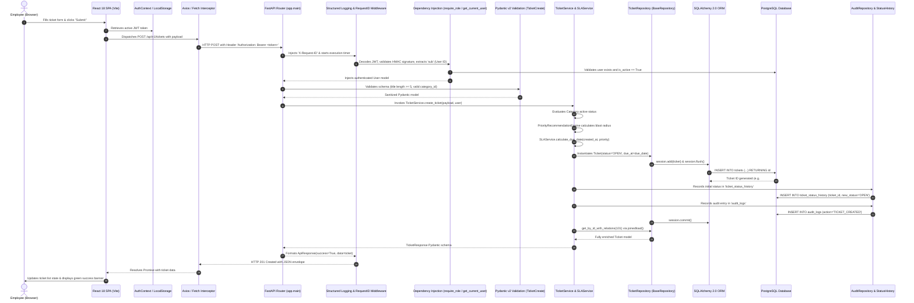

# 21. Detailed End-to-End Project Flow Explanation

This document explains the complete, unbroken execution trace of an issue lifecycle in TrackIT, tracing every single hop from user interaction, React state management, HTTP transport, FastAPI middleware, RBAC verification, Service execution, SQLAlchemy persistence, to the final UI update.

---

## The Execution Flow Diagram



---

## Step-by-Step Breakdown

### 1. Employee Logs In
- Employee enters email and password on the React login screen (`/login`).
- `authService.login()` issues `POST /api/v1/auth/login`.
- FastAPI route calls `AuthService.authenticate_user()`.
- The database is queried for the user by email (`UserRepository.get_by_email()`).
- `verify_password()` compares the plaintext password against the Bcrypt salt and hash.
- Upon verification, `create_access_token()` mints a cryptographically signed HMAC-SHA256 JWT containing `sub` (user ID), `role`, `email`, and `exp` (expiration time).
- React stores the token in `localStorage` and updates `AuthContext` state.

### 2. Employee Creates a Ticket
- Employee enters issue details:
  - **Title**: *"VPN connectivity drops every 10 minutes"*
  - **Category**: *Network*
  - **Priority Recommender**: Selects 25 affected users, Department Blocked $\rightarrow$ algorithm suggests `HIGH` priority with an 8-hour SLA deadline.
- Submitting the form calls `ticketService.createTicket()` in React.

### 3. React Sends HTTP POST
- Outbound fetch request sent to `/api/v1/tickets`.
- The API interceptor in [`frontend/src/services/api.js`](file:///c:/Users/harit/OneDrive/Desktop/TrackIT%20%E2%80%94%20Smart%20IT%20Service%20&%20Issue%20Management%20Platform/frontend/src/services/api.js) attaches `Authorization: Bearer <token>`.

### 4. FastAPI Gateway & Middleware Interception
- The request hits [`backend/app/main.py`](file:///c:/Users/harit/OneDrive/Desktop/TrackIT%20%E2%80%94%20Smart%20IT%20Service%20&%20Issue%20Management%20Platform/backend/app/main.py).
- Structured logging middleware assigns a unique UUID correlation ID (`X-Request-ID`) to the request context.

### 5. Authentication & RBAC Verification
- The dependency `get_current_user` in [`backend/app/core/dependencies.py`](file:///c:/Users/harit/OneDrive/Desktop/TrackIT%20%E2%80%94%20Smart%20IT%20Service%20&%20Issue%20Management%20Platform/backend/app/core/dependencies.py) decodes the JWT using `JWT_SECRET_KEY`.
- If the token is expired, missing, or malformed, it immediately halts and raises a 401 Unauthorized exception.
- It queries the database to ensure the user exists and `is_active == True`.

### 6. Pydantic Input Validation
- The request body is validated against [`TicketCreate`](file:///c:/Users/harit/OneDrive/Desktop/TrackIT%20%E2%80%94%20Smart%20IT%20Service%20&%20Issue%20Management%20Platform/backend/app/schemas/ticket.py):
  - `title`: String with length between 5 and 200 characters.
  - `description`: String with length between 10 and 5000 characters.
  - `category_id`: Positive integer.
- Any validation failure immediately aborts with a 422 Validation Error and detailed field-level error messages.

### 7. TicketService Business Logic Execution
- In [`backend/app/services/ticket_service.py`](file:///c:/Users/harit/OneDrive/Desktop/TrackIT%20%E2%80%94%20Smart%20IT%20Service%20&%20Issue%20Management%20Platform/backend/app/services/ticket_service.py):
  - Validates that the requested category exists and is currently active.
  - Sanitizes title and description.
  - Invokes `SLAService.calculate_due_date()` to compute `due_at = created_at + timedelta(hours=8)`.
  - Sets initial lifecycle status to `TicketStatus.OPEN`.

### 8. Persistence via Repository & SQLAlchemy ORM
- In [`backend/app/repositories/ticket_repository.py`](file:///c:/Users/harit/OneDrive/Desktop/TrackIT%20%E2%80%94%20Smart%20IT%20Service%20&%20Issue%20Management%20Platform/backend/app/repositories/ticket_repository.py):
  - Adds the new `Ticket` entity to the SQLAlchemy session.
  - Generates the initial status history entry in `ticket_status_history` (`old_status=None, new_status="OPEN"`).
  - Records an audit log entry in `audit_logs` (`action="TICKET_CREATED"`).
  - Commits the transaction atomically to PostgreSQL.

### 9. API Response Serialization
- `TicketService._enrich_ticket_response()` executes `SLAService.evaluate_sla_status()`.
- Calculates real-time SLA metrics: `sla_status="ON_TRACK"`, `sla_remaining_hours=8.0`, `is_breached=False`.
- Returns a standardized envelope:
  ```json
  {
    "success": true,
    "data": {
      "id": 101,
      "title": "VPN connectivity drops every 10 minutes",
      "status": "OPEN",
      "priority": "HIGH",
      "sla_status": "ON_TRACK",
      "due_at": "2026-10-14T22:30:00Z"
    },
    "message": "Ticket created successfully"
  }
  ```

### 10. React UI Reactive Update
- React receives the 201 Created response.
- Navigates the employee to `/tickets` or displays the new ticket card on the `EmployeeDashboard`.
- The live countdown badge renders green with `ON_TRACK` status.
