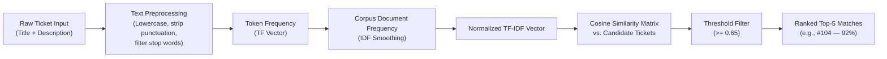

# TrackIT Incident Intelligence — Architecture & Interview Reference

> **Topic**: Similarity-Based Ticket Analysis & Rule-Based Escalation Recommendation  
> **Target Audience**: Associate Product Engineer / Software Engineer Freshers & Technical Interviewers  
> **Approach**: Transparent Data Structures & Algorithms (TF-IDF + Cosine Similarity) + Deterministic Risk Scoring  

---

## 1. Executive Summary & Why This Was Added

In enterprise IT Service Management (ITSM), multiple employees often encounter and report the same underlying infrastructure breakdown at the same time:
* When a VPN gateway or DNS server fails, 30 employees across 5 departments may each raise separate tickets within 20 minutes (e.g., *"Cannot connect to VPN"*, *"Office VPN failure"*, *"Remote access gateway timeout"*).
* Without similarity detection, support agents triage each ticket in isolation, duplicating diagnostic effort, delaying root-cause discovery, and failing to detect that a major outage is underway.

To solve this, **TrackIT Incident Intelligence** was built around two transparent, explainable innovations:
1. **Related Ticket Detection**: Analyzes ticket title and description using **TF-IDF Vectorization** and **Cosine Similarity** to automatically uncover similar active or recent issues.
2. **Smart Escalation Recommendation**: Aggregates ticket severity, blast radius (affected users), real-time SLA deadline pressure, and cluster size (number of related tickets) into an **explainable rule-based risk score**.

---

## 2. What Is TF-IDF?

**TF-IDF** stands for **Term Frequency – Inverse Document Frequency**. It is a classical Information Retrieval and Natural Language Processing numerical statistic that reflects how important a word is to a specific document within a larger collection (corpus).

### A. Term Frequency ($\text{TF}$)
Measures how frequently a term $t$ appears in document $d$:
$$\text{TF}(t, d) = \frac{\text{Count of } t \text{ in } d}{\text{Total terms in } d}$$
* If the word *"vpn"* appears 3 times in a 12-word ticket description, $\text{TF}(\text{"vpn"}, d) = \frac{3}{12} = 0.25$.

### B. Inverse Document Frequency ($\text{IDF}$)
Measures how rare or informative a term is across all documents in the corpus $D$:
$$\text{IDF}(t) = \ln\left(\frac{1 + |D|}{1 + \text{DF}(t)}\right) + 1.0$$
* Words that appear in almost every ticket (like *"problem"*, *"laptop"*, or common stopwords) receive a **low IDF score** because they do not help distinguish one specific issue from another.
* Highly specific domain terms (like *"wireguard"*, *"vpn"*, *"blue-screen"*) appear in relatively few tickets, receiving a **high IDF score**.
* We use a smooth IDF formula ($+1.0$ smoothing) to prevent division by zero and ensure smooth scaling.

### C. TF-IDF Weight
$$\text{Weight}(t, d) = \text{TF}(t, d) \times \text{IDF}(t)$$
A word receives a high weight only if it appears frequently in the target ticket **and** is uniquely characteristic across the candidate tickets.

---

## 3. What Is Cosine Similarity?

**Cosine Similarity** measures the cosine of the angle between two multi-dimensional numerical vectors $\mathbf{u}$ and $\mathbf{v}$ in vector space:

$$\text{Cosine Similarity}(\mathbf{u}, \mathbf{v}) = \frac{\mathbf{u} \cdot \mathbf{v}}{\|\mathbf{u}\| \|\mathbf{v}\|} = \frac{\sum_{i=1}^{n} u_i v_i}{\sqrt{\sum_{i=1}^{n} u_i^2} \times \sqrt{\sum_{i=1}^{n} v_i^2}}$$

### Why Cosine Similarity Instead of Euclidean Distance?
* **Length Invariant**: In support tickets, one user might write a short 6-word summary (*"VPN connection dropped"*) while another writes a 40-word paragraph detailing their home Wi-Fi setup.
* Euclidean distance penalizes documents of different lengths heavily.
* Cosine similarity measures the **directional alignment** (angle) of term weights regardless of total word count, ranging from $0.0$ (completely unrelated/orthogonal) to $1.0$ (identical vocabulary distribution).

---

## 4. End-to-End Similarity Calculation Pipeline

1. **Text Normalization**:
   - Combine title and description: `f"{title} {description}"`.
   - Convert to lowercase.
   - Strip punctuation using regular expressions (`[^a-zA-Z0-9\s]`).
   - Remove IT-specific stop words (*the, and, for, please, issue, help*).
   - Safely handle empty or missing descriptions by falling back to title tokens.
2. **Candidate Selection**:
   - Instead of scanning all historical tickets (which scales poorly), TrackIT pre-filters candidates to:
     - Same category ID **or** active tickets (`OPEN`, `ASSIGNED`, `IN_PROGRESS`, `REOPENED`).
     - Excludes the target ticket itself (`id != target.id`).
     - Caps candidate pool to the most recent 100 tickets.
3. **Similarity Cutoff & Ranking**:
   - Computes cosine similarity between target vector and each candidate vector.
   - Retains candidates meeting or exceeding the configurable threshold (**default: 0.65**).
   - Ranks matches descending by score and returns top 5.

---

## 5. Smart Escalation Recommendation Engine

Rather than relying on an opaque, unexplainable black-box machine learning model, TrackIT utilizes a **deterministic, rule-based risk evaluation engine**.

### Scoring Rules Matrix

| Signal Category | Condition | Points | Explainable Reason Output |
|---|---|---|---|
| **Priority Severity** | `CRITICAL` | **+2** | *"CRITICAL priority issue"* |
| | `HIGH` | **+1** | *"HIGH priority issue"* |
| **Blast Radius** | $\ge 20$ affected users | **+2** | *"High blast radius: {N} affected users"* |
| | $10 - 19$ affected users | **+1** | *"Moderate blast radius: {N} affected users"* |
| **SLA Urgency** | `BREACHED` | **+2** | *"SLA deadline has breached"* |
| | `AT_RISK` ($< 25\%$ SLA remaining) | **+1** | *"SLA is at risk of breaching"* |
| **Incident Cluster** | $\ge 5$ related tickets | **+2** | *"High volume cluster: {N} similar tickets detected"* |
| | $3 - 4$ related tickets | **+1** | *"Emerging trend: {N} similar tickets detected"* |

### Score-to-Recommendation Mapping

$$\text{Total Score} = \text{Score}_{\text{priority}} + \text{Score}_{\text{users}} + \text{Score}_{\text{sla}} + \text{Score}_{\text{related}}$$

* **0 – 2 Points** $\to$ **`NORMAL`** (Green badge)  
  *Standard queue processing. No immediate intervention required.*
* **3 – 4 Points** $\to$ **`MONITOR`** (Amber badge)  
  *Moderate urgency. Support lead should monitor resolution progress.*
* **5+ Points** $\to$ **`ESCALATION RECOMMENDED`** (Red/Rose badge)  
  *High blast radius, critical impact, or recurring incident cluster. Immediate supervisor notification or tier-2 reassignment recommended.*

---

## 6. Example Walkthrough Scenarios

### Scenario A: Enterprise VPN Outage (Cluster Escalation)
* **Ticket #104**: Title: *"VPN connection is not working"*, Priority: `HIGH` (+1), Affected users: `25` (+2).
* **System Scan**: Discovers 5 related tickets with $>85\%$ similarity in the Network category. Related count $\ge 5$ (+2).
* **SLA Status**: Ticket nearing its 24h deadline, marked `AT_RISK` (+1).
* **Total Risk Score**: $1 + 2 + 2 + 1 = 6$ points ($\ge 5$).
* **Recommendation**: **`ESCALATION RECOMMENDED`**  
  *Reasons*:
  - HIGH priority issue
  - High blast radius: 25 affected users
  - High volume cluster: 5 similar tickets detected
  - SLA is at risk of breaching

### Scenario B: Individual User Non-Blocking Request
* **Ticket #105**: Title: *"Slack profile avatar upload fails"*, Priority: `LOW` (+0), Affected users: `1` (+0).
* **System Scan**: 0 related tickets found (+0).
* **SLA Status**: 71 hours remaining out of 72h SLA, marked `ON_TRACK` (+0).
* **Total Risk Score**: $0$ points.
* **Recommendation**: **`NORMAL`**  
  *Reasons*:
  - No significant escalation indicators detected.

---

## 7. Security & Role-Based Access Control (RBAC)

The intelligence endpoints enforce strict row-level authorization:
* **Employees**: Can ONLY view intelligence for tickets they originally created. Attempting to query `/api/v1/intelligence/tickets/{id}/related` on another employee's ticket immediately returns `403 Forbidden` (`FORBIDDEN`).
* **Support Agents & Admins**: Can view intelligence for all tickets they are authorized to triage and monitor.
* **Audit Trail**: Generates lightweight entries in `audit_logs` (`RELATED_TICKETS_VIEWED` and `ESCALATION_ASSESSMENT_GENERATED`).

---

## 8. Interview Defense & Technical Trade-Offs

### Q1: Why not use a Vector Database (Pinecone, ChromaDB, Milvus) and LLM Embeddings?
> **Candidate Answer**:
> *"For an internal IT service management platform with tens of thousands of tickets, introducing an external vector database, embedding API keys (like OpenAI), and network latency adds massive infrastructure cost, vendor lock-in, and unpredictable non-deterministic outputs.
> Pure-Python TF-IDF runs in under 2 milliseconds directly in-memory, requires zero external dependencies, costs $0/month, and produces 100% deterministic, explainable mathematical output that support leads can verify."*

### Q2: Why rule-based escalation instead of a trained classifier (e.g. Random Forest)?
> **Candidate Answer**:
> *"IT service escalations require immediate explainability. If an IT director asks why a ticket was escalated to P1/P2, a rule-based engine provides clear, human-readable bullet points (e.g., '25 users affected, 5 similar tickets, SLA breached'). A trained black-box classifier gives a probability with no actionable audit trail, and requires continuous retraining data that fresh software installations do not yet possess."*

### Q3: What are the limitations and how would you evolve this in production?
> **Candidate Answer**:
> 1. **Synonym Handling**: Pure TF-IDF matches exact word stems. If one user says *"Wi-Fi down"* and another says *"WLAN unreachable"*, TF-IDF won't match them unless a lightweight domain synonym dictionary or n-gram stemming is applied.
> 2. **Scaling to Millions of Tickets**: In a hyper-scale enterprise with 10M tickets, computing TF-IDF over 100 candidates is still fast, but candidate selection can be indexed using PostgreSQL Full-Text Search (`tsvector` / GIN index) before applying Cosine Similarity on top.
